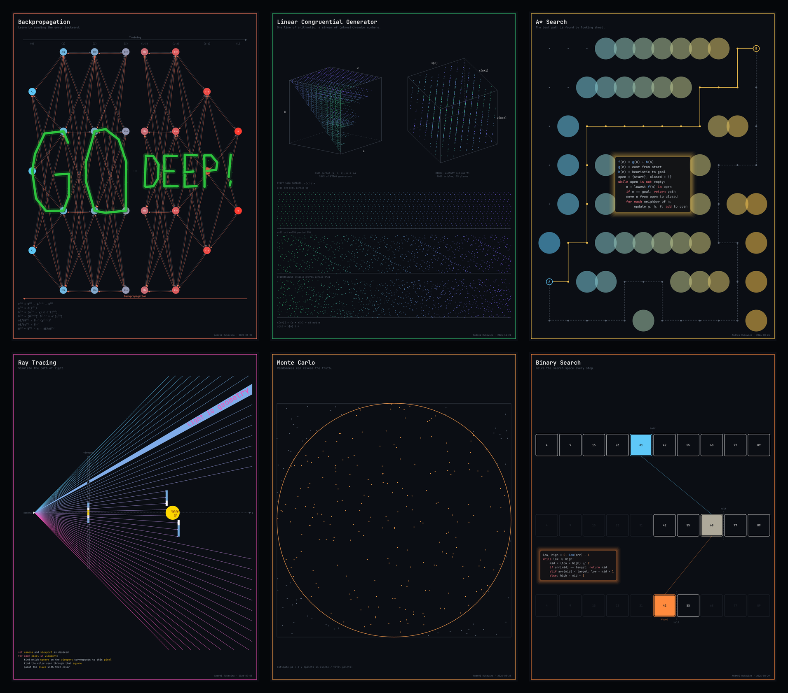

# Algorithmic Art Frames

**Famous algorithms, drawn as minimalist posters. One Python file each.**

Algorithmic Art Frames is an educational, open source project for people learning data visualization and for anyone who loves making art with computers. Each poster turns a famous algorithm into a print-ready SVG: a title, a one-line tagline, a generative diagram and the pseudocode behind it. Every poster here is published on [pseudocode.art](https://pseudocode.art).

Some examples:



## Why contribute

This is a passion project. You don't need to be the best programmer or the best designer to add a poster, and nobody is keeping score. In a time when AI can generate almost anything in seconds, a poster here is something you made yourself: an algorithm you care about, drawn the way you see it. Pick one, give it your own style, and share it.

**Ready?** The steps below are all it takes, and [CONTRIBUTING.md](CONTRIBUTING.md) has the full details. All you need is Python.

## Add your own poster

Each poster is a plugin: one Python module with a title, a tagline, a pseudocode snippet and a `draw(ctx)` function that returns an SVG.

### 1. Fork and set up

Clone this repo and install it with the dev tools. Steps 1 and 5 are also all you need to explore the existing posters.

```bash
git clone https://github.com/arukavina/algo-art-frames-public.git
cd algo-art-frames-public
python -m venv .venv
source .venv/bin/activate          # Windows PowerShell: .venv\Scripts\Activate.ps1
pip install -e ".[dev]"
```

### 2. Copy the template

Copy the template to a new `snake_case` file named after your slug, for example `dijkstra.py` for the slug `dijkstra`.

```bash
cp src/algo_art_frames/algorithms/_template.py src/algo_art_frames/algorithms/dijkstra.py
```

### 3. Draw your diagram

Set `TITLE` and `TAGLINE` once, fill in `PSEUDOCODE` and `draw(ctx)`. `new_canvas()` lays out the title, tagline and pseudocode and returns the box to draw into; use the `ctx.theme` colors so the poster works in both dark and light.

```python
TITLE = "Binary Search"
TAGLINE = "Halve the search space every step."

def draw(ctx: RenderContext) -> str:
    dwg, box = new_canvas(ctx, title=TITLE, tagline=TAGLINE, pseudocode=PSEUDOCODE)
    # ... draw into `box` with dwg.rect / dwg.text / dwg.line / dwg.circle ...
    return dwg.tostring()
```

Pick the closest `category` from `AlgorithmCategory` in `base.py`. `binary_search.py` and `quicksort.py` are good references for the level of detail expected.

### 4. Register it

Import your module in `src/algo_art_frames/algorithms/__init__.py` and add it to the `_MODULES` tuple, then add your slug to `EXPECTED_SLUGS` in `tests/test_algorithms.py`.

### 5. Preview every variation

Render your poster in both themes with every display option (frame, pseudocode, tagline and author, on and off), then open the SVGs in any browser.

```bash
python -m algo_art_frames.preview dijkstra --variations   # 32 files in out/
python -m algo_art_frames.preview dijkstra --frame --theme dark
python -m algo_art_frames.preview --help                   # every option
```

### 6. Check and open a PR

Run the checks first:

```bash
pytest
ruff check .
```

To send your poster you need a **fork**: your own copy of this repo on GitHub. Only maintainers can push branches to this repo, so contributors push their branch to their fork and open a pull request from there. With the [GitHub CLI](https://cli.github.com):

```bash
gh repo fork --remote          # creates your fork; it becomes "origin" and this repo "upstream"
git checkout -b my-poster
git add src/algo_art_frames/algorithms/dijkstra.py src/algo_art_frames/algorithms/__init__.py tests/test_algorithms.py
git commit -m "feat: add dijkstra poster"
git push -u origin my-poster
gh pr create                   # opens the pull request against this repo's main
```

Without the CLI: click **Fork** at the top of this repo's GitHub page, add your fork as a remote with `git remote add fork` followed by your fork's URL, push with `git push -u fork my-poster`, and open the pull request from the banner GitHub shows on your fork.

CI runs the checks again and renders previews of every poster. Once a maintainer approves and merges it, your poster is published on pseudocode.art.

## What CI checks

Merged posters are published automatically, so every PR runs the same contract tests you ran locally. A plugin:

- imports only `algo_art_frames` and a short list of standard-library modules;
- doesn't use `eval`, `exec`, `open`, `__import__` or similar built-ins;
- renders in under 2 seconds and under 1 MB of SVG, in both themes;
- draws the same title and tagline it lists in `PLUGIN`;
- changes visibly when each display option is switched;
- never renames or removes an existing slug.

## Layout

```
src/algo_art_frames/
  algorithms/
    base.py           # the plugin contract: AlgorithmPlugin, AlgorithmCategory
    __init__.py       # the registry (REGISTRY) built from the _MODULES tuple
    _template.py      # copy this to start a new algorithm
    <one module per algorithm>.py
  render/
    canvas.py         # new_canvas(): background, title, tagline, pseudocode, layout box
    theme.py          # dark and light theme presets
    syntax.py         # pseudocode syntax highlighting
  preview.py          # renders posters to SVG files for local review
tests/
  test_algorithms.py  # every plugin is registered and renders valid SVG
  test_contract.py    # safety and consistency checks (see CONTRIBUTING.md)
```

## How a merged poster goes live

1. You open a PR here. CI runs the lint, the tests and the safety checks, and uploads rendered SVG previews of every poster as a workflow artifact.
2. A maintainer reviews the poster and approves the PR (when possible)
3. Once it's merged into `main`, your poster is published on pseudocode.art automatically.

## License

[MIT](LICENSE)
